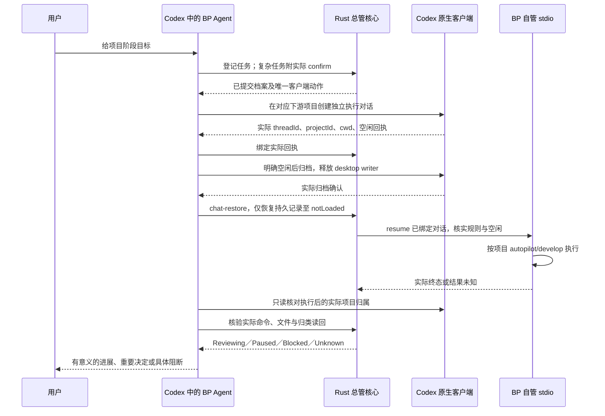

# BridgePilot 运行协议

日期：2026-10-31。需求、授权与分批结果以 [TODO-050 开发计划](../../1_delivery/bridgepilot-evolution/plan_2026-10-30_bridgepilot-evolution.md) 为准。本文区分当前实现与未激活能力，不表示完整 BP 已验收。

## 1. 代码架构

```text
source/
├─ forge/                         # 九包、模板、通用工程流程
└─ orchestrator/                  # 与 forge 平行，无 src 中间层
   ├─ lib.rs / main.rs / cli.rs   # Rust 库、JSON CLI、严格参数
   ├─ domain.rs                  # 项目、机器绑定、任务、确认、Run、操作意图
   ├─ store.rs                   # 不可变修订、原子 HEAD、CAS、本机锁
   ├─ codex.rs                   # 自管 stdio、停止、未知结果核对
   ├─ owned.rs                   # 自有进程树、单调期限、Windows 创建身份
   ├─ scheduler.rs               # 有限时长常驻调度、跨项目并行与待办观察
   ├─ review.rs                  # 真实命令与文件核验、项目归属交付闸门
   ├─ grouping.rs                # desktop 旧 ID 到 server ID、原生赋值与成员核对
   ├─ wakeup.rs                  # 原生 heartbeat 登记、读回与明确范围
   ├─ delivery.rs                # 受管开发证据、固定发布提交与实际 push URL 核对
   └─ skills/bridgepilot/         # 当前 Codex 对话的本地入口
scripts/tests/orchestrator/       # 域、存储、子进程夹具与故障测试
```

依赖方向：orchestrator → forge/core，Forge 不依赖总管。公共安装只投影原公共八包，factory 九包单独准备；orchestrator 不进入公共模板、共享 Skill 或 `.codex/hooks/source/`。通用 core 变化只公开既有 ProcessTree API，复用 Windows 无控制台、启动时 Job 归属及 Drop 停止机制。

## 2. 用户工作流与执行接入



只有一个执行适配器：BP 自管 stdio App Server。原生客户端负责创建和归类，通过已提交 outbox 交接；Rust 核心不能调用当前会话的内部 MCP 工具。初始原生对话只确认接入。实测 idle 仍持有桌面 writer，因此需原生归档确认、stdio `thread/unarchive` 同 ID 且 notLoaded 的数据恢复，才能让直接 execute 或 scheduler 认领。恢复前持久记 Attempted，失败、重复、暂停／归属漂移均不放行。创建工具自身的人类授权要求继续有效。

| 路径 | 已核实 | 未证明 |
|---|---|---|
| 原生客户端 | 明确授权后创建 StratusAgent、HoldemTrainer 两个聊天；归档释放 writer；stdio 执行后的原生历史可读；move 接口返回目标项目确认 | recent 和 history 仍读回 projectId=null，桌面项目归类未核实，不能把 move ACK 当作验收 |
| 自管 stdio | 在上述真实聊天各完成一项只读模型任务，实际 cwd、sandbox、AGENTS、命令、终态落盘并独立核对；数据恢复无新增任务回合 | 项目技能驱动的真实开发／发布、真实暂停中断与双机接管 |
| Rust 子进程夹具 | 完成、暂停、批准请求拒绝、丢响应恢复、错误握手、错误关联及 CAS 竞态通过实际测试 | 夹具通过不代表真实 Codex 业务端到端通过 |
| 默认 proxy | 当前环境连接控制 socket 失败，os error 10050 | 不归因为产品原理上不支持，不擅自修复原生服务 |
| stdio 对话移入项目 | 旧隔离对话的 cwd 是工厂临时测试目录，move 无法安全识别来源 | 该失败不能外推全部 stdio 不支持项目；当前仍无稳定归类读回，不以原生数据库写入绕过 |

协议探测见 `.runtime/tests/bridgepilot-stage2/bridgepilot-stage2-real-probe.json`；第三阶段真实任务、交接和报告核验见 `.runtime/tests/bridgepilot-stage3/` 及唯一开发计划。实际根 AGENTS 来源和交接前后摘要已核实，未发送 model/effort 覆盖；不认证所有宿主设置完全一致。受限 PowerShell 的中文回显、非终止错误和 Git 全局忽略文件权限警告保留在原回执中。

## 3. 对象与状态

Project 使用稳定 ID 和仓库身份；路径、原生 projectId、host 属于机器绑定。不同 Project 不得映射同机同工作树或原生项目。任务含目标、非目标、验收、依赖、复杂度、逐项授权，spec_hash 绑定完整输入。

简单明确任务直接 Ready，复杂任务 AwaitingConfirm。task-confirm 须引用真实人类决定与当前摘要；程序不认证人类来源，Agent 不得捏造。task-revise 使旧确认失效。依赖任务未实际交付时不能派发。

Run 保存任务摘要、单调 ordinal、机器、绑定快照、thread/turn、owner/server PID、模型、规则摘要及结果。同项目至多一个 Prepared／Running／Pausing／Unknown 活跃归属；未知不释放归属，不凭心跳超时接管。重复输入去重不重建 Task；同修订暂停续跑保留 Task 与原对话并新增 Run，改变修订不复用旧修订对话。

| 外部结果 | 当前任务状态 |
|---|---|
| completed | Reviewing，只证明模型回合结束，未认证验证、收口或发布 |
| interrupted | Paused，需明确 resume |
| failed／权限需要用户处理 | Blocked，不自动批准或当作成功 |
| 响应丢失／无法核对 | Unknown，禁止重复派发 |

只读 report-review 校验结果摘要、实际 command_id、成功状态、非截断输出、项目 cwd 与原始文件摘要。失败、乱码与截断历史保留；实际内容仍由当前 Agent 核对。内核可消费本 Run 已 Observed 的原生归类 proof，无实际归类则保持 Reviewing；匹配后 ReportDelivered。文件漂移时不更新摘要冒认旧报告。来源引用不是加密认证。

写任务的 verify-development 只消费项目受管 develop --preview 的当前任务范围结论，不补做测试、升版或发布；成功进入 AwaitingRelease。verify-publication 在任务已有明确发布授权后核对真实受管收据、固定提交、正式版本、收口账本和实际推送端点，成功才 Released。模型 completed、普通 sync 或本地提交不能释放发布依赖；细节见第 8 节。

## 4. 档案与配置

安装、备份、恢复只在 [INSTALL.md](../../../INSTALL.md#bridgepilot-本地试用与档案恢复) 维护。产品仓库不保存个人档案，本机位置在 `.runtime/config/bridgepilot.json`。

```text
<私有工作区>/doc/5_project_knowledgebase/bridgepilot/
├─ HEAD.json
└─ revisions/<revision>-<sha256>.json
<私有工作区>/.runtime/
├─ config/bridgepilot-machine.json
└─ bridgepilot/locks/ 与 index/
```

schema=1，完整修订最大 16 MiB；拒绝重复 JSON key、未知结构字段、链接／reparse 路径、损坏历史。每份修订含 archive ID、递增 revision、父 HEAD、完整状态。提交先取 core FileLock，验证 HEAD／完整父链与 expected revision，校验新状态，写入并刷盘不可变修订，最后原子替换 HEAD。HEAD 安装成功才提交。

中断留下的孤立修订不自动提升；HEAD 缺失、摘要冲突或断链时停止写入，不自动回退可能发生外部动作的状态。摘要用于完整性，不是身份认证。status 零写入，rebuild-index 只重建可丢弃索引；清理不能删除长期修订。物理掉电、网络盘、云盘冲突未验证；本机锁和 CAS 不构成跨机全局锁。完整快照及全历史读取适用于个人规模，暂不压缩或自动删历史。

## 5. 外部动作、暂停与恢复

先提交 Operation 意图，再记 Attempted 后调用外部接口，最后记实际 Observed 回执。超时无平台幂等保证，不重发创建或 turn/start。客户端回执须匹配绑定 projectId、canonical cwd、实际空闲状态，不能编造 ID。创建未知时先找到实际对话再绑定，不能猜测没有创建。

execute 核实绑定快照，先持久记归属再启动 owned ProcessTree；resume 要求精确 thread ID、完整 turn 数组和全部已知终态，校验 sandbox、实际 cwd、AGENTS。缺字段、未知状态或规则变化不按空闲处理。批准请求拒绝后保留给用户，不自动批准。

`execute --timeout-seconds` 覆盖握手、归类、任务和停止确认。有用户阶段上限时使用剩余时间；用户取消整体上限后，单次执行仍使用有限窗口，保存真实状态后接续，不凭窗口到期宣称任务完成。执行端提前留最多 10 秒尝试 interrupt，自管定时器仅持 owned ProcessTree 的 Weak，到上限回收该 Job；正常 Drop 取消定时器，不按外部 PID 杀进程。接收、RPC 返回及终态事务复核期限；迟到或缺失终态 Unknown。操作系统和档案 I/O 不构成实时保证。

暂停仅接受全部项目或明确非空 ID 集合。模糊、重复、未知范围拒绝且零状态变更。先关闭所选范围派发，再 interrupt；请求接受不等于停止，必须等实际终态。完成与暂停竞态按实际终态进入核对。未尝试的创建意图可取消；已尝试但无回执保持 Unknown。重复暂停不丢原阶段，其他项目继续。

run-reconcile 不启动新回合，不接受 Prepared／终态 Run。Windows 新记录在 resume_execution 操作中保存 owner/server PID 与创建身份；创建身份来自原 Child handle／当前进程，核对时只查询，PID 被不同创建身份复用不视作旧 owner。身份查询失败仍阻断；旧记录缺创建身份时保守要求原 PID 不存在，不伪补历史身份或对外部 PID 发 kill。历史须精确关联且无在途／未知状态；有 turn_id 时匹配该 turn，否则只接受 userMessage 开头完整匹配 run、start operation、spec_hash、ordinal 的派发包。

历史读取后以原始 snapshot.revision 提交，任何新归属或操作变化都 CAS 拒绝，不用旧观察覆盖新执行。未尝试 start_turn 时，须原 owner 已退出且历史明确空闲后才记“未发起任务回合”，仍需明确 resume，不伪造业务结果。

## 6. 有限时长常驻调度

`supervise` 显式指定项目集合、1–8 并行数和有限时长；同机同档案仅一个监督锁。轮转项目，每项目只拥有一个活跃 Run，持续观察新任务、依赖交付和客户端回执；缺确认、创建／交接待办或未知归属不自行跨越。stop_when_idle=false 等待新工作至期限，true 可在批次空闲时退出；Prepared 等待真实客户端动作仍属于待处理。

监督器先记 launch_worker Attempted，再启动独立 worker，Observed 必须保存确切 PID 和可用的创建身份。worker 等待该回执，并在等待结束及认领事务再次验证自己；监督进程与实际执行 owner 分开，不冒认其他进程。Supervisor 和 worker 共用单调绝对时限，回收只作用于自有 Job／进程树；外部独立树不会被停止。进程退出但缺持久终态则 Unknown；重启不自动认领或重复执行。只有受阻项目停派发，其他明确授权项目可继续。

等待客户端交接时，已有 prepare_execution_chat 操作只读等待，不为每次 tick 追加无变化档案修订；操作尚不存在时才创建。周期性的本机 supervisor 状态文件与长期不可变档案分别管理。

控制状态和有界 stdout/stderr 尾部在私有工作区 `.runtime/bridgepilot/supervisor.json`，长期实际结果仍在不可变档案；本机日志不是发布凭证。操作系统和存储调度仍有误差，不能宣称实时上限保证。

## 7. 原生项目归类与持续唤醒

本机桌面仍保留旧项目 ID，当前 App Server 的 project/list 返回另一套 server ID。BP 不把二者直接比较，也不从名称猜映射；要求一个可验证的单根项目 canonical 路径唯一匹配，project/read 前后复核目录，再通过原生 thread/metadata/update 赋值。Operation 先 Attempted；返回后分别读取 thread/read、project/read 和按项目过滤的 thread/list（useStateDbOnly=true），确认实际成员。BindingRequired 的内部调用还必须核对当前 owner 的 PID 与创建身份。丢响应后只读核销，不能重复未知写入；暂停／身份漂移不认证。全过程不直接写原生 SQLite、设置、会话文件或 Memory，不创建模型回合。

归类意图在原生 RPC 前通过 Store.update 提交；其他项目推进造成全档案修订变化或暂时 writer 锁竞争时，可有界重试这一本地步骤。每次都重核当前 Run／owner／spec／绑定／暂停，并复用既有同 kind 操作，不能从旧观察直接改写新归属。只有本地意图成功持久化后才允许首次原生写入，原生调用及 Unknown 不参与重试；run-reconcile 的终态 CAS 仍严格拒绝旧结果覆盖。

桌面工具摘要中的 projectId 可能为空；它不是底层归类的唯一证据。真实 server ID、desktop ID、根路径与项目成员回执全部保留。第四阶段继续调查发现：客户端归档路径保存内存隐藏状态，stdio 的 thread/unarchive 不会触发该客户端的恢复确认／列表广播。仅执行底层 metadata 修复不能完成这部分交接。已结束任务通过原生客户端完成一次 archive→unarchive 后，两项聊天的客户端列表均读回正确旧项目 ID，截图也实际显示在各自项目侧栏。不是通过重启或改数据库修复。

这一步由私有 BP Skill 驱动原生客户端完成，不把 GUI API 塞进 Rust 执行器。前置是当前本机 Run Completed、实际 owner/server 已退出、项目没有活跃／Unknown Run、原生聊天空闲；先查已有回执，成功不重复。归档和恢复保存真实客户端回执，任一步未知先核对，禁止重新开始整个周期。已在活动存储的 rollout 直接 unarchive 会报 no archived rollout，先完成一次明确的原生客户端归档再恢复；该受控交接不是未知操作重试。当前实测只覆盖两项已完成只读任务，不能外推执行中、暂停或跨机聊天。此步骤不运行模型、改业务或认证发布。界面观察以截图为准，不能仅依赖可能滞后的无障碍树或列表摘要。

持续唤醒由当前 Codex 对话的原生 heartbeat 承担，不另建 OS 服务或独立 cron。wake-plan 保存控制对话、机器、项目集合、周期和完整提示词；wake-attempt 后才调用原生工具，wake-bind 保存实际回执，并只读核对原生 automation.toml 的 id／kind／状态／目标对话／周期／提示词。wake-check 每次重新读原生配置，不信任旧 Active 缓存；只读检查不追加长期修订，不因定时触发授予新执行或发布权限。

重复 plan 仅首次 Planned 给出创建动作；Attempted／Unknown 只允许查询，已注册状态复用原 native ID。修改范围须先通过原生接口暂停、绑定实际 Paused，再 wake-revise 和原生 update，保持一个心跳，不删除历史。新字段以默认空映射读取早期 schema 1 修订，升级后使用新程序；旧版程序不保证读取扩展后的档案。

心跳需要电脑与桌面应用在线；不支持关闭应用或关机后的本地执行。实际触发是否在当前长回合忙碌时合并／延迟，以原生调度为准，不承诺精确到秒或并发打断。同一控制对话不启用多个监督器，不自动接管旧机。开发阶段按用户要求报告粗进度；目标完成后空闲安静，只报告有意义变化。

## 8. 开发与发布证据

development-probe／verify-development 限定项目已有受管工具入口和明确包集合，要求 task-development-current、空 pending／affected 与所需能力；两次零写入预览之间核对 Git 根／HEAD／分支／状态、VERSION、AGENTS、版本合同、收口账本和工具摘要。失败不手写收据、不补验证。任务入口绑定当前结果摘要、任务修订、本机与项目，禁止覆盖其他活跃 writer；成功只到 AwaitingRelease。

发布必须先有本任务发布授权、开发核验和本项目 .runtime 中原样保存的真实 schema 4 受管发布收据。校验和解析使用同一份字节；要求真实 release、升主版本及成功 push、提交／版本／子包范围和已核验账本一致。从 Git 的实际 push 配置和 refspec 确定 remote/ref，不用 upstream 代替；live ls-remote 固定查询经登记仓库身份匹配的 push URL，避免 fetch URL 与 push URL 不同造成假发布，末尾再复核配置未漂移。当前合同只接受一个明确登记的推送仓库。

核对固定发布提交和远端分支实际指向，不以整个工作树必须清零为前提；无关脏文件保留并报告。仅本地提交、普通同步、无升版、错误目标、证据变化或远端未证实都不标 Released。来源由当前 Agent 核对，文件摘要只保护完整性，不把可手写 JSON 宣称为加密签名或人类授权认证。本模块不执行 fetch、commit、push、release 或版本写入。

实现验证包含受控 native preview／收据样本和真实隔离 Git bare 远端；不等于真实业务项目已发布。真实 BP 自身开发证据探测及原生唤醒触发结果另在开发计划按实际续记。

## 9. 私有同步、控制权交接与独立安装

实现为 BP 私有模块 sync、handoff、install，不进入公共 Forge 投影。具体操作仅在根 INSTALL.md 维护。首次显式 enrol 引入可缺省 custody：owner、epoch、handoff、代码 checkpoints、已核验 bindings 与 continuation。空缺保持早期档案可读；启用后旧 reader 不再兼容，安装事务不暗改档案。常规写事务检查本机 owner、冻结和 pending；只读下载不授予执行权。

同步以 GitHub 私有仓库为传输，缓存 bare repo/index/pending 在本机 .runtime。只允许固定 archive 根的 HEAD 与完整不可变父链，不 checkout 远端、不开通公共仓库、不传原生会话／Memory／日志／凭据。Git 无强推，应用 HEAD 另核对真实祖先；拒绝分叉、回退、未引用修订、未知路径和非普通文件。无活跃 Run 的同步边界持单 writer 锁；远端确认后保存真实回执。推送前持久 pending；结果未知查询远端实际提交／祖先，不自动重发。

全控制器交接须全部项目明确暂停、所有执行归属已停止、每项目有实际远端代码检查点。主对话按项目 git-sync 权限保存代码，内核 checkpoint-probe 仅验证，不能提交脏代码。release 本地先冻结；accept 先验证新机每个实际代码绑定，远端独占变更确认后才本地激活。旧机不能写；竞争接受或取消均由远端 Git ref 与应用父链挡住。未确认释放的取消以新的 Git 分支子提交发布栅栏，迟到旧释放不能 FF；取消候选落盘前保留原恢复记录。

接续不改写旧 Run 机器、原始结果或 confirm。用户恢复明确范围后，指定 task 的 continuation 保存旧阶段／Run／来源，新 Run 追加上下文并以新机绑定准备新聊天；旧证据不冒充新机核验。接受不自动启动任务或迁移 heartbeat；新聊天仍遵守工具授权。源机历史缺进程 birth 时默认要求真实 PID 不存在；唯一额外兼容路径仅用于派发前已核销的本机终态 server：原 owner 必须不存在，以真实启动／supervisor／核销收据和同一原生线程终态，再用 Toolhelp 镜像名证明 PID 已复用。本机 proof 绑定机器、档案、Run／操作、PID和证据摘要，消费时重核，不改历史、不豁免 Unknown 或 owner。enrol 只登记备份 owner，不借此宣称历史全部进程已核验；真正 release 保持严格停止门禁。

便携包含真实 core、Rust 稳定 launcher、固定 asset ID／target／hash 的私有 Skill 和控制入口。独立 home 的安装日志保存旧字节；版本目录不可变，current 最后切换，中断可恢复或保留外部修改待处理。保留旧包，回退前旧程序读取真实档案；不相容则拒绝，不回滚数据伪装相容。configure 接受受核验安装 home，不伪造 Forge manifest。安装不改旧 Forge、公共 Skill、PATH 或登录信息。

## 10. 剩余验证与未实现项

- 原生 heartbeat 已登记，实际激活与首个触发状态见唯一开发计划，不以配置存在代替运行通过。
- 两项目原生数据、项目成员、客户端列表和实际侧栏显示已核验；真实开发暂停／恢复及双项目发布未验收。
- 跨机交接、代码检查点、同步冲突与独立安装已实现；隔离多工作区、真实 GitHub 与实际安装验证按唯一开发计划分别记录，不能外推为两台物理电脑、掉电或网络盘已通过。
- 开发发布核验已实现；真实业务发布与完整稳定验收尚未完成，回合终态仍默认 Reviewing。

新增真实下游写入、业务运行和发布仍须有相应授权，不把两项只读验证扩张为开发授权。控制原理参考[官方 App Server](https://learn.chatgpt.com/docs/app-server)、[原生定时任务](https://learn.chatgpt.com/docs/automations?surface=app)与[Git refspec](https://git-scm.com/docs/git-fetch)；当前实验字段以本机生成 schema 和实际响应为准。
