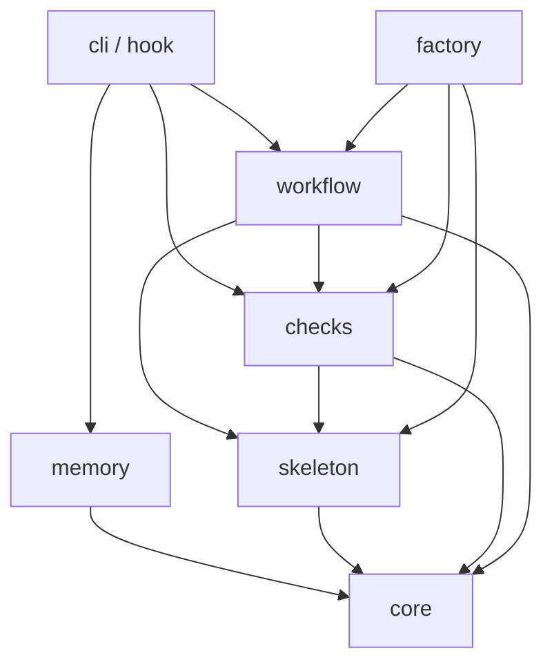

# Rust 源码、公共投影与工厂工具

工程 Rust 唯一维护源位于根 workspace 的 `source/forge/`。目录使用简短职责名，Cargo 原生包名仍为 `bridgeforge-*`。`.codex/hooks/` 是由受管生成器产生的公共运行时投影，不作为第二份维护源。

BP 总管位于平行的 `source/orchestrator/`，按 tasks、storage、execution、transfer、install、cli 六个独立包组织；不依赖该总管即可使用 Forge 工程能力。BP 包不进入公共源码投影，受管版本登记与公共分发名单分别管理。拆分验证与收口状态以 [六包拆分记录](../../1_delivery/bridgepilot-package-split/plan_2026-11-02_package-split.md)为准，产品整体进展见 [TODO-050 计划](../../1_delivery/bridgepilot-evolution/plan_2026-10-30_bridgepilot-evolution.md)。

| 目录 | 职责 | 主要边界 |
|---|---|---|
| `source/forge/core` | 进程、文件与锁、JSON、持久化、构建输入/缓存/收据、公共源码投影、基础版本类型 | 不作同步、发布或 Memory 业务决策 |
| `source/forge/skeleton` | 骨架合同与基线核验、内容合并、项目 Hook 注册和隔离构建 | 负责骨架语义，不编排 Git 发布 |
| `source/forge/workflow` | Git 同步、原生发布协调、项目同步和公共产物准备 | 调用项目原生入口构建，确认源码推送后执行平台发布 |
| `source/forge/memory` | Codex 原生 Memory 同步、远端、冲突、所有权、恢复与后台工作 | 不解析或改写官方 Memory 正文 |
| `source/forge/checks` | 文档、Skill、TODO、产物布局、指令来源与编码规则 | 返回结构化报告，不拥有 Hook 事件或 CLI 输出流程 |
| `source/forge/factory` | 工厂 manifest、dogfood、工厂工具与公共产物准备 | 仅工厂使用 |
| `source/forge/cli` | 公共 `bridgeforge` 命令解析与输出适配 | 主程序版本载体；规则调用对应能力包 |
| `source/forge/hook` | Hook 事件、输入筛选、会话状态、检查结果与退出码适配 | 主程序版本载体；Windows 无控制台入口 |

根 `Cargo.toml` 显式登记工程成员；`workspace.metadata.bridgeforge.public-members` 选出七个公共包，`factory-members` 选出八个工厂构建包。公共与工厂投影均裁剪清单及依赖闭包锁文件，排除后续总管包及其专属依赖。维护源 `source/forge/<包>` 映射为原有逻辑 `source/<包>`，公共目标仍为 `.codex/hooks/source/<包>/`，不因仓库归组迁移下游目标和既有资产 ID。实际源与独立快照都必须能够锁定构建；再次投影保持幂等。

通用 Skill 唯一维护源为 `source/forge/templates/skills/`；分发清单保留各 Skill 的显式 source、安装 target 和 hash。用户级安装目标仍为 `~/.codex/skills/`，本仓库只镜像已登记的自身 Skill，不把全部 Skill 安装到每个下游。

BP 主版本取自根 `VERSION`，Forge 版本取自 CLI 的 `Cargo.toml`，其余包使用各自的原生版本。项目负责自身版本和依赖锁；工厂从正式源码生成公共投影。

工厂准备从根 workspace 当前源码启动 `bridgeforge-factory`，准备公共 CLI、无控制台 Hook 和私有工厂工具；源码、锁、配方、环境、二进制与收据共同决定复用。公开 CLI 的工厂兼容入口只调用身份核验通过的本地工厂工具。安装与恢复入口为 [INSTALL.md](../../../INSTALL.md)。

本轮实施与验证状态见 [TODO-032 需求卡](../../1_delivery/source-workspace-refactor/requirements_2026-10-24_source-workspace.md)。九包源码、公共投影、dogfood 与独立版本已落地，实际验证以需求卡和受管收据为准；真实下游、正式用户级安装与自然生命周期验证不在本轮范围内。
